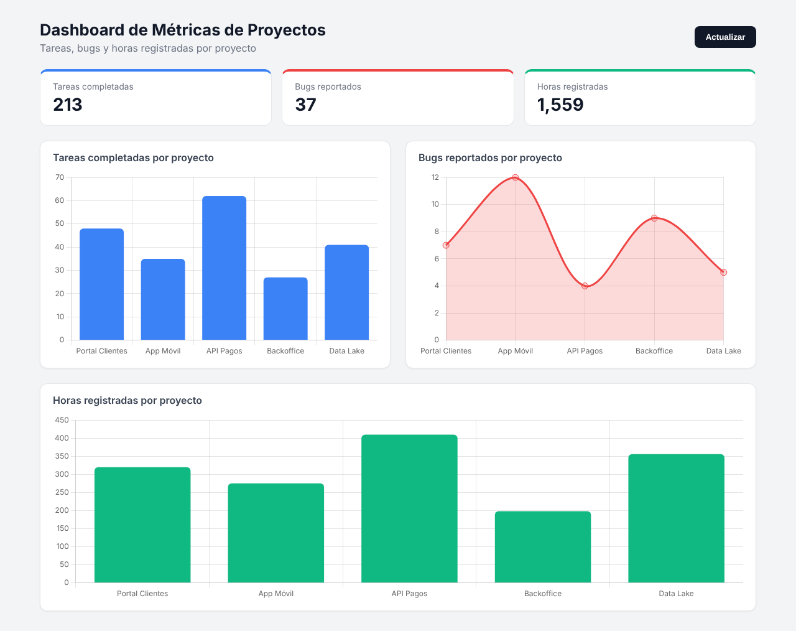

# Dashboard de Métricas de Proyectos



Proyecto final **IAI-GENAI-3.02 – Proyecto Web**.
Dashboard que obtiene métricas de proyectos (tareas completadas, bugs reportados y horas registradas) de una API REST simulada y las muestra en gráficos interactivos.

## Framework y tecnologías

| Elemento | Tecnología |
|---|---|
| Framework | **Angular 22** (componentes standalone + signals) |
| Lenguaje | TypeScript |
| Gráficos | **ng2-charts** (wrapper de Chart.js 4) |
| API simulada | `src/api.ts` → `fetchProjectMetrics()` (responde después de 1 s) |
| Herramientas | Node.js, npm, Angular CLI, Git |

## Requisitos previos

- Node.js 20.19+ o 22.12+ (recomendado 22 LTS)
- npm 10+
- (Opcional) Angular CLI global: `npm install -g @angular/cli`

## Instalación

```bash
git clone <url-del-repositorio>
cd dashboard-proyecto
npm install
```

## Ejecución

```bash
npm start          # equivale a: ng serve
```

Abre http://localhost:4200/ en el navegador. Las métricas aparecen tras ~1 segundo (latencia simulada). El botón **Actualizar** vuelve a llamar a la API.

### Build de producción

```bash
npm run build      # salida en dist/dashboard-proyecto/browser
```

## Estructura

```
src/
├── api.ts                                  # API REST simulada (fetchProjectMetrics)
└── app/
    ├── app.ts / app.html / app.css         # Componente principal (dashboard)
    ├── app.config.ts                       # provideCharts(withDefaultRegisterables())
    └── components/
        ├── grafico-de-barras/              # Componente reutilizable: inputs titulo, datos
        ├── grafico-de-lineas/              # Componente reutilizable: inputs titulo, datos
        ├── tarjeta-metrica/                # Tarjeta KPI reutilizable
        └── grafico.css                     # Estilos compartidos de los gráficos
```

## Funcionalidad

- **Obtiene datos de la API simulada** en `ngOnInit` y los guarda en un `signal`.
- **Tarjetas KPI** con los totales de tareas, bugs y horas.
- **Gráfico de barras**: tareas completadas por proyecto.
- **Gráfico de líneas**: bugs reportados por proyecto.
- **Reutilización**: `GraficoDeBarras` se usa dos veces (tareas y horas) con distintos `titulo`, `datos` y `color`.
- Estados de carga y error.

## Uso de los componentes reutilizables

```html
<app-grafico-de-barras titulo="Tareas completadas por proyecto" [datos]="tareasPorProyecto()" />
<app-grafico-de-lineas titulo="Bugs reportados por proyecto" [datos]="bugsPorProyecto()" />
```

`datos` es un arreglo de `{ etiqueta: string; valor: number }`. Inputs opcionales: `color` y `serie`.

## Uso de GitHub Copilot

En [`COPILOT.md`](./COPILOT.md) están los prompts usados en cada modo de Copilot (Agente, Preguntar, Finalizaciones en línea y Edición).
